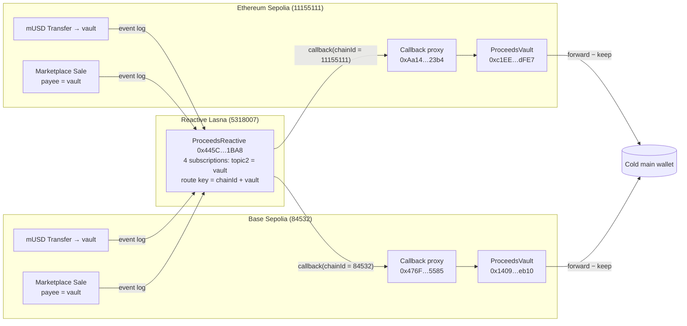
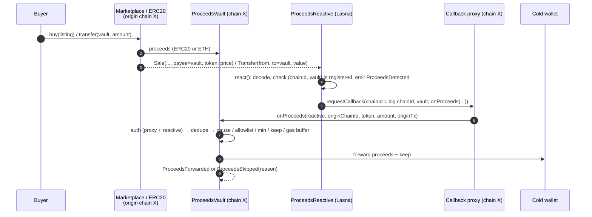

# Proceeds Auto-Forward

**Reactive Omni Buildathon · track: _Set It and Forget It_ · testnet only**

Sell something, get paid, and the money lands in your cold wallet by itself, on whichever chain it
arrived. No bot, no keeper, no server, no cron job to babysit.

## The story

I flip NFTs. Listings live in a **hot burner wallet** because that's the key I'm willing to paste into
mint tools and marketplaces. The problem: every sale's proceeds sit in that burner until I remember to move
them, which is exactly the wallet most likely to get drained. The usual fix is a bot on a VPS that polls
balances and signs transfers, which means another hot key, another server, another thing that dies at 3 am.

Proceeds Auto-Forward removes the bot. Sales pay a small **vault** contract instead of the burner. A
**reactive contract** on Reactive Network watches the chain for money arriving at that vault, and Reactive
Network itself delivers a callback that tells the vault to forward the proceeds to the cold wallet, under
rules the owner set (allowed tokens, minimums, how much to keep, an ETH gas buffer). Nobody holds a key that
can move the money except the vault owner, and nothing off-chain has to stay online.

It works for any seller, not just NFT flippers: shops taking stablecoin invoices, creators collecting
royalties, DAO treasuries sweeping income into a multisig.

**One reactive contract, two chains, live:** the same `ProceedsReactive` on Lasna serves a vault on
Ethereum Sepolia and a vault on Base Sepolia. Adding Base Sepolia needed no redeploy and no code change on
the reactive side, only two `watch*` calls.

## Architecture





### Routing rules

Each route is one Reactive subscription, keyed by origin chain:

| Owner call (Lasna) | Subscribes to | Callback goes to |
| --- | --- | --- |
| `watchToken(chainId, token, vault)` | `Transfer(from, to, value)` on `token`, `topic2 = vault`, on `chainId` | `vault` on the same `chainId` |
| `watchMarketplace(chainId, market, vault)` | `Sale(listingId, payee, paymentToken, price, seller, buyer)` on `market`, `topic2 = payee = vault` | `vault` on the same `chainId` |
| `unwatchToken` / `unwatchMarketplace` | removes that subscription | |

The callback always targets the chain where the event happened, because that's where the money is: a vault
can only forward funds it actually holds. `react()` reads `log.chainId` and passes it straight to
`requestCallbackV_1_0`, and a vault is only accepted if it was registered **for that chain**
(`keccak256(chainId, vault)`), so the same address on another chain is ignored.

Live routes: Sepolia mUSD + Sepolia marketplace → Sepolia vault; Base Sepolia mUSD + Base Sepolia
marketplace → Base Sepolia vault.

### Contracts

| Contract | Chain | Role |
| --- | --- | --- |
| `src/reactive/ProceedsReactive.sol` | Reactive Lasna | Owner registers routes per origin chain. `react()` decodes ERC20 `Transfer` (opCode 3, so ERC721 transfers are filtered out) and marketplace `Sale` logs and requests a callback to the vault on the origin chain. Ignores zero amounts and unregistered `(chainId, vault)` pairs without reverting. |
| `src/destination/ProceedsVault.sol` | Sepolia, Base Sepolia (any supported chain) | `AbstractCallback`. `onProceeds` is guarded by `onlyServiceProvider` (this chain's callback proxy) **and** `onlyCallbackSender` (our reactive contract). Applies the owner's rules and never reverts on a business rule, so a rejected forward is a cheap `ProceedsSkipped` event instead of a billed `CallbackFailure`. |
| `src/mocks/MockMarketplace.sol` | Sepolia, Base Sepolia | Fixed-price marketplace with a payout address per listing; pays the payee in ERC20 or ETH and emits `Sale`. |
| `src/mocks/MockUSD.sol` | Sepolia, Base Sepolia | 6-decimal test stablecoin with an open `mint`. |

### Owner rules (vault)

| Rule | Setter | Effect |
| --- | --- | --- |
| Main wallet | `setMainWallet` | Where proceeds go. |
| Token allowlist + min + keep | `setTokenRule(token, allowed, minAmount, keep)` | Unlisted tokens stay in the vault; reported amounts below `minAmount` are skipped; `keep` is retained from each forward. `address(0)` = native ETH. |
| Native gas buffer | `setNativeGasBuffer` | ETH below this level is never forwarded, so the vault keeps paying callback fees. |
| Pause | `setPaused` | Proceeds accumulate; nothing is forwarded. |
| Escape hatch | `sweep(token, to, amount)` | Manual withdrawal of anything. |
| Revive | `coverDebt()` (public) | Settles callback-proxy debt from the vault balance. |

Skip reasons: `0 Paused, 1 TokenNotAllowed, 2 BelowMinimum, 3 AlreadyProcessed, 4 NothingToForward,
5 TransferFailed`.

## Security model

- **Who can trigger a forward.** `onProceeds` checks two things: `msg.sender` must be the Reactive callback
  proxy of *this* chain (`onlyServiceProvider`), and the first argument, which the network overwrites with
  the requesting reactive contract, must equal our `ProceedsReactive` (`onlyCallbackSender`). A direct call,
  another chain's proxy, or another reactive contract are all rejected (tests:
  `test_CallbackRejectsDirectCaller`, `test_CallbackRejectsOtherReactiveContract`,
  `test_BaseSepoliaLoopForwardsThroughItsOwnProxy`).
- **Who can trigger a callback.** `react()` is `onlySystem`; routes are `onlyOwner`; a log is acted on only
  if its `(chainId, vault)` pair was registered, so spoofed payees and cross-chain look-alikes are ignored.
- **Where money can go.** Only to `mainWallet`, set by the owner. The reactive side never names a
  recipient, only "check your balance for this token".
- **Never over-forwards.** The amount sent is `min(reported, spendable) − keep`; native spendable excludes
  the gas buffer. An inflated or bogus report can't move more than the vault actually holds.
- **Dedupe.** One forward per `(originChainId, originTxHash, token)`. A marketplace sale in an ERC20 fires
  both the `Transfer` and `Sale` routes; the second callback is skipped as `AlreadyProcessed` (seen live in
  loops 3 and base2). Same tx hash on two chains counts as two payments (`test_DedupeKeyIncludesOriginChain`).
- **Callbacks never brick.** Business rules and failed transfers emit `ProceedsSkipped` instead of
  reverting, and token transfers use a low-level call that tolerates non-standard tokens.
- **Everything is logged.** `ProceedsDetected` / `ForwardRequested` on Lasna; `CallbackReceived`,
  `ProceedsForwarded`, `ProceedsSkipped(reason)` and every config change on the vault.

## Live deployment (testnet)

| Contract | Chain | Address | Sourcify |
| --- | --- | --- | --- |
| ProceedsReactive | Lasna 5318007 | [`0x445C336410F0A49e45893e10c25E39B804F81BA8`](https://lasna.reactscan.net/address/0x445C336410F0A49e45893e10c25E39B804F81BA8) | [match](https://repo.sourcify.dev/5318007/0x445C336410F0A49e45893e10c25E39B804F81BA8) |
| ProceedsVault | Sepolia 11155111 | [`0xc1EEA4ddD643462402539726a99F1a7Ebd50dFE7`](https://sepolia.etherscan.io/address/0xc1EEA4ddD643462402539726a99F1a7Ebd50dFE7) | [match](https://repo.sourcify.dev/11155111/0xc1EEA4ddD643462402539726a99F1a7Ebd50dFE7) |
| MockMarketplace | Sepolia | [`0x406e7E7FA57f9534C9Ce350Afa4f23eF0F5faA6c`](https://sepolia.etherscan.io/address/0x406e7E7FA57f9534C9Ce350Afa4f23eF0F5faA6c) | [match](https://repo.sourcify.dev/11155111/0x406e7E7FA57f9534C9Ce350Afa4f23eF0F5faA6c) |
| MockUSD | Sepolia | [`0xd16Be1D20f1FFee777F54BC2F65bD11A710E86c7`](https://sepolia.etherscan.io/address/0xd16Be1D20f1FFee777F54BC2F65bD11A710E86c7) | [match](https://repo.sourcify.dev/11155111/0xd16Be1D20f1FFee777F54BC2F65bD11A710E86c7) |
| ProceedsVault | Base Sepolia 84532 | [`0x1409483E8c6C620a87494059941D5401f6c3eb10`](https://sepolia.basescan.org/address/0x1409483E8c6C620a87494059941D5401f6c3eb10) | [exact match](https://repo.sourcify.dev/84532/0x1409483E8c6C620a87494059941D5401f6c3eb10) |
| MockMarketplace | Base Sepolia | [`0x122B2884708F232A199f89e2E64A6DB4795A26Ec`](https://sepolia.basescan.org/address/0x122B2884708F232A199f89e2E64A6DB4795A26Ec) | [exact match](https://repo.sourcify.dev/84532/0x122B2884708F232A199f89e2E64A6DB4795A26Ec) |
| MockUSD | Base Sepolia | [`0x445C336410F0A49e45893e10c25E39B804F81BA8`](https://sepolia.basescan.org/address/0x445C336410F0A49e45893e10c25E39B804F81BA8) | [match](https://repo.sourcify.dev/84532/0x445C336410F0A49e45893e10c25E39B804F81BA8) |
| Callback proxy (Reactive) | Sepolia / Base Sepolia | `0xAa14d9Cd0f788Ca23d11805986C1d8bd035D23b4` / `0x476F44b11F5C942c58f4c8E3d0300E5710743585` | |
| Deployer / owner / demo main wallet | all | `0xc1e54b2522627099ba45936CBa066e6adA928993` (testnet burner) | |

Note: Base Sepolia `MockUSD` and Lasna `ProceedsReactive` share an address because both were the deployer's
first contract (nonce 0) on their chain. They are unrelated contracts.

Vault rules in the demo (both chains): mUSD allowed, min 5 mUSD, keep 1 mUSD per forward; ETH allowed,
min 0.00001 ETH, gas buffer 0.00001 ETH.

Sepolia mocks were compiled against OpenZeppelin `master` at `efaa6f7` (the repo now pins OZ v5.4.0) and
were verified from that commit. Every other contract verifies from this repo as is. Etherscan/Basescan
verification was not done (needs API keys); both explorers can import from Sourcify.

### Setup transactions

| Step | Chain | Tx |
| --- | --- | --- |
| Faucet 0.006 Sepolia ETH → lREACT | Sepolia | [0x644404…d2](https://sepolia.etherscan.io/tx/0x64440492d2b513244dcdae1ee752c318fc7c0031986bc2535a260e43c5fba2d2) |
| Deploy ProceedsReactive (0.2 lREACT) | Lasna | [0x516011…db](https://lasna.reactscan.net/tx/0x516011eecd0a64aee597c52cbb414494ea140e56ffb26996c1de6582f18dd6db) |
| Deploy Sepolia vault | Sepolia | [0x564e5b…3a](https://sepolia.etherscan.io/tx/0x564e5b65c0852d761ab9fe834354a9455d562c462dbe4e7f92a7f543521dee3a) |
| Sepolia routes: watchToken / watchMarketplace | Lasna | [0x653ab2…fc](https://lasna.reactscan.net/tx/0x653ab25cc6280eb39b1ca157ecdefa40c1babdb3cb92c0d58cc07f02417594fc) / [0xfc3087…7f](https://lasna.reactscan.net/tx/0xfc308784089516e78d91b2bcd4b7335f5283b4bb13efd4f21840d1356431557f) |
| setCallbackGasLimit(1M) | Lasna | [0x685788…08](https://lasna.reactscan.net/tx/0x6857888679e223f6e68cfee9f2eabb299d4235bfb10a41c285a22514ba8ca208) |
| Bridge 0.0012 ETH Sepolia → Base Sepolia (official `L1StandardBridge` `0xfd0B…3120`, `depositETH`) | Sepolia | [0x5c0853…46](https://sepolia.etherscan.io/tx/0x5c0853d250dc8e7662351f25121fc8be338958c1a3c7223030e586ff3e274146) |
| Deploy MockUSD / MockMarketplace / vault | Base Sepolia | [0x9d6fbd…44](https://sepolia.basescan.org/tx/0x9d6fbd9393355361b8594c2fc2694204a36585227d65e225747d0a024f264644) / [0x28a3fe…fc](https://sepolia.basescan.org/tx/0x28a3fe646a16529c7d6d73d8beccd83f43613b2fa61e76658ed83f09ffb157fc) / [0x3f924b…00](https://sepolia.basescan.org/tx/0x3f924b53d1b08da73a99304433ca85e85f514790022474feaf3e1d34aeb5c900) |
| Vault rules mUSD / ETH | Base Sepolia | [0x47e5c7…db](https://sepolia.basescan.org/tx/0x47e5c7348eefb14d6349862374698a7caa55373b39033d4086e2999757110ddb) / [0xafbc4d…f8](https://sepolia.basescan.org/tx/0xafbc4d036a1e37eb96bbc29c2ca75cc7799b2697e1a83e100b35f3961aef89f8) |
| Base Sepolia routes: watchToken / watchMarketplace (same reactive contract) | Lasna | [0x75e0e3…25](https://lasna.reactscan.net/tx/0x75e0e3fb624aa83dfebd53a5850e6ce1ffb935944ea933106bfcbb3058df8525) / [0x147fad…52](https://lasna.reactscan.net/tx/0x147fadb09c5d4de6a10a057752bc6f4708d06d5800b3ab39191dc64a89293f52) |

## Full loops on-chain (origin event → reactive tx → callback)

### Ethereum Sepolia

| # | Scenario | Origin tx (Sepolia) | Reactive tx (Lasna) | Callback tx (Sepolia) | Result |
| --- | --- | --- | --- | --- | --- |
| 1 | Direct payment 25 mUSD, callback gas limit 500k | [0xe9aa95…b921](https://sepolia.etherscan.io/tx/0xe9aa95ef54686ff8c0be62243aad641f956295f9ea0b9adc086ae289cb0db921) | [0x2e2a60…2d3f](https://lasna.reactscan.net/tx/0x2e2a60a4ca94080c1dc2178f34ce42ac010e928c93aafdd7000730da2a852d3f) | [0x6917ef…afb8](https://sepolia.etherscan.io/tx/0x6917efaa098493ddba23295fb673af7e9a24f27d2a974d0b9c1a168bd736afb8) | `CallbackFailure`: out of gas (see note). Gas limit raised to 1M: [0x685788…a208](https://lasna.reactscan.net/tx/0x6857888679e223f6e68cfee9f2eabb299d4235bfb10a41c285a22514ba8ca208) |
| 2 | Direct payment 25 mUSD | [0xdc8a5b…a9e7](https://sepolia.etherscan.io/tx/0xdc8a5be179ad50bef4bd686599e9eb035cf44139cdd93b3a997bc2924c29a9e7) | [0x1482bb…6ea2](https://lasna.reactscan.net/tx/0x1482bb472585490347f3cbfe587a37c2c3164efb9695c15c89f66a7984196ea2) | [0xedb849…9705](https://sepolia.etherscan.io/tx/0xedb849ec2b8cb7ca9f23b67c2c6fba791432944a00587bc6e44aa603f1a79705) | **Forwarded 24 mUSD**, kept 1 |
| 3 | Marketplace sale 40 mUSD (fires Transfer **and** Sale routes) | [0x04d960…178f](https://sepolia.etherscan.io/tx/0x04d96024c32be76dcf0a8eb574bba84b0e1043cd8b357660db56aa9a4e52178f) | [0x17efa5…2b1b](https://lasna.reactscan.net/tx/0x17efa5d1113bfab7fcb266684b64a79593cc23da41374590223cf4ccf79f2b1b), [0x6ce056…c84c](https://lasna.reactscan.net/tx/0x6ce056117d98526afc3a188bc83ac6fa325670f575fceec6bb7ba308bc52c84c) | [0xd8f530…e775](https://sepolia.etherscan.io/tx/0xd8f5309d32eb35ed194e53733dc8f716eb7b1cc357c14bd45e4a17914afee775), [0x09fad7…3569](https://sepolia.etherscan.io/tx/0x09fad7a457754b6f86aadb3d07e7375d2f6a81f6c590960d3fd32c6fe7733569) | **Forwarded 39 mUSD** once; duplicate skipped (`AlreadyProcessed`) |
| 4 | Marketplace sale 0.0002 ETH | [0xe5c4c5…2d8e](https://sepolia.etherscan.io/tx/0xe5c4c5ffc4dd22a3af2b41092945311d5ebf8368c2a2fd1f86961bebf5c52d8e) | [0x44cc6b…2e35](https://lasna.reactscan.net/tx/0x44cc6bd43e057d7e7a103484e745817a4e73d832700ad52519e082d3f7132e35) | [0x1d29a5…6aff](https://sepolia.etherscan.io/tx/0x1d29a5a9d1a45f7179a88b0eb254ba4d83ba23ab911bdeb11c72e483b8916aff) | **Forwarded 0.0002 ETH**, gas buffer untouched |
| 5 | Dust payment 2 mUSD (< 5 min) | [0x48d3a5…6261](https://sepolia.etherscan.io/tx/0x48d3a5df11cab7dff80eda3a6aced7e5cdd6b446267c5def77c4f2d9a5b06261) | [0x6a5779…3776](https://lasna.reactscan.net/tx/0x6a57797e55974b9704528adb1428e72c876e366c3398e4f84221bc56c0a13776) | [0x0529ad…c1f8](https://sepolia.etherscan.io/tx/0x0529adfa2c81ea93ae691ab87d27d304878b6f93336675f01770a63b0a33c1f8) | Skipped (`BelowMinimum`), funds stay in vault |

**Note on loop 1:** the first callback ran with a 500k gas limit. The proxy withholds its own accounting
gas, and on current Sepolia a cold ERC20 transfer plus the dedupe write cost more than local estimates,
so `onProceeds` ran out of gas after the token transfer and the whole call reverted (nothing moved,
proxy logged `CallbackFailure`). The fix was a one-line owner call on Lasna (`setCallbackGasLimit(1_000_000)`),
and the default in `script/Deploy.s.sol` is now 1M. The 25 mUSD from loop 1 is still in the vault and
can be pulled with `sweep`.

### Base Sepolia (same reactive contract)

| # | Scenario | Origin tx (Base Sepolia) | Reactive tx (Lasna) | Callback tx (Base Sepolia) | Result |
| --- | --- | --- | --- | --- | --- |
| base1 | Direct payment 25 mUSD | [0x301166…736f](https://sepolia.basescan.org/tx/0x3011669dd06bda006369eef4d748605e030a2ac396a260583d41bf71a8a5736f) | [0x51c753…c5bc](https://lasna.reactscan.net/tx/0x51c7536682e6cad8c1d149ffc1cfe04d44887f7b635ef7934f9b7e36b2bec5bc) | [0x855603…e1d4](https://sepolia.basescan.org/tx/0x85560312efef7758652d9a533a0895ba24d8a440c6ab1d6d18119026e347e1d4) | **Forwarded 24 mUSD**, kept 1 |
| base2 | Marketplace sale 40 mUSD (Transfer **and** Sale routes) | [0x2c8ca1…c97f](https://sepolia.basescan.org/tx/0x2c8ca1486e0359e366f78e51ea17cec71fc6d6857bde80bad5404a42e3a9c97f) | [0x228fbc…6bef](https://lasna.reactscan.net/tx/0x228fbc0dbfb3dad5fa0ffc8f55dafae65be2bb38f31bda63a68c270a18e56bef), [0xa17252…7d60](https://lasna.reactscan.net/tx/0xa1725256de5d33071e141efdd1f7d10b0a50f7dda5778d467519427865697d60) | [0x0a0314…fbc0](https://sepolia.basescan.org/tx/0x0a031490eebff515c2bd93068aa4e1a7a57f273100d92ebba07e76e0ff62fbc0) (forward), [0x6d592f…27ab](https://sepolia.basescan.org/tx/0x6d592f4eab4618d29a9c67b1ab33bc5a4df385ad75fc2396e216b5808ead27ab) (dup skip) | **Forwarded 39 mUSD** once; duplicate skipped (`AlreadyProcessed`) |
| base3 | Marketplace sale 0.00005 ETH | [0x12e1ca…85cd](https://sepolia.basescan.org/tx/0x12e1caa7f578ac0142ff2a9c240dffac3a5644a311be59223b57e759d92785cd) | [0x51bfd2…1ca4](https://lasna.reactscan.net/tx/0x51bfd2419ba6c338c903e031bfe23ff0dd16f29d5346614e5e6f282c08a91ca4) | [0x23ad2e…453d](https://sepolia.basescan.org/tx/0x23ad2ef9849afdade3fc354746f5419b2a0fa4acae20af31bea27a984282453d) | **Forwarded 0.0000474929 ETH**: the sale minus what earlier callbacks had already drawn from the 0.00001 ETH gas buffer, so the buffer was topped back up before forwarding |

All hashes are also in [`runs/loops.tsv`](runs/loops.tsv); raw broadcast receipts are in `runs/*.json`.

## Latency

Measured from block timestamps read over RPC ([`runs/latency.py`](runs/latency.py) →
[`runs/latency.tsv`](runs/latency.tsv)). Leg 1 = origin block → Lasna block containing the reactive tx;
leg 2 = reactive block → callback block on the origin chain. For loops with two reactive or callback txs the
first one is used.

| Loop | Chain | Origin → reactive (s) | Reactive → callback (s) | Full loop (s) | Origin blocks until callback |
| --- | --- | ---: | ---: | ---: | ---: |
| loop1-direct-gas500k | Sepolia | 0 | 12 | **12** | +1 |
| loop2-direct | Sepolia | 0 | 12 | **12** | +1 |
| loop3-tokenSale | Sepolia | 0 | 12 | **12** | +1 |
| loop4-nativeSale | Sepolia | 1 | 11 | **12** | +1 |
| loop5-dust | Sepolia | 0 | 12 | **12** | +1 |
| base1-direct | Base Sepolia | 0 | 2 | **2** | +11 |
| base2-tokenSale | Base Sepolia | -1 | 2 | **1** | +6 |
| base3-nativeSale | Base Sepolia | 0 | 2 | **2** | +6 |

Base Sepolia: n=3 median full loop 2 s, min 1 s, max 2 s

Sepolia: n=5 median full loop 12 s, min 12 s, max 12 s

Takeaways:
- **Reactive Network adds essentially no delay.** The reactive tx lands in the Lasna block with the same
  timestamp as the origin block (0 s, ±1 s; Lasna and the origin chains stamp blocks at 1-second resolution,
  which is where the single `-1` comes from).
- **The callback is bound by the destination's block time.** On Sepolia (12 s blocks) every callback landed
  in the very next block (+1). On Base Sepolia (~200 ms blocks) callbacks landed 6–11 blocks later, i.e.
  1–2 s after the payment.
- End to end, proceeds reached the cold wallet in **12 s on Sepolia** and **1–2 s on Base Sepolia**.

## Costs observed

| Item | Cost |
| --- | --- |
| Reactive tx (Lasna, paid by `ProceedsReactive`) | ~0.013 lREACT each (0.2 → 0.0667 lREACT over 10 reactive txs) |
| Callback on Sepolia (paid by the vault) | ~3·10⁻¹¹ ETH |
| Callback on Base Sepolia (paid by the vault) | ~8·10⁻⁷ ETH (~140k gas at 0.006 gwei) |
| Base Sepolia deployment (3 contracts + 2 rules, incl. 0.00001 ETH vault funding) | ~0.000021 ETH |

## Demo video

[`demo/demo.mp4`](demo/demo.mp4) (2:49, 1080p, **narrated in English with an AI voice**, on-screen captions)
walks through the idea, architecture, code highlights (subscribe → `react()` → `onProceeds()`), `forge test`
(39/39), Sepolia loops 2–4 step by step with tx hashes, blocks and decoded events, results of all five
Sepolia loops (incl. the loop-1 out-of-gas fix), Sourcify verification, and the Base Sepolia second chain
(3 loops, 1–2 s vs 12 s on Sepolia). The narration is AI text-to-speech (Microsoft neural voice
`en-US-AndrewNeural` via `edge-tts`); the script with timestamps is in [`demo/voiceover.txt`](demo/voiceover.txt).
The quiet background pad is synthesized from scratch (`demo/build/music.py`, no samples or third-party music).
Stills: [`demo/screenshot-architecture.png`](demo/screenshot-architecture.png),
[`demo/screenshot-loop3-dedupe.png`](demo/screenshot-loop3-dedupe.png). Rebuild with `demo/build/fetch.py`,
`build_vo.py`, `render.py`, `assemble.sh`, `build_vo.py --mix`, `music.py <seconds>`, `mix.sh`.

## Tests

```
forge test        # 39 tests in 3 suites, all offline, incl. a fuzz test
forge coverage    # ProceedsReactive 100% lines / 100% funcs, ProceedsVault 100% lines / 100% funcs
```

| Suite | What it covers |
| --- | --- |
| `test/ProceedsAutoForward.t.sol` (21) | Full local loops: the `_relay()` helper turns recorded EVM logs into `LogRecord`s, feeds the ones matching the contract's own subscriptions into `react()`, and delivers each callback through a mock proxy that rewrites the first argument like the network. Direct payment, token sale with dedupe, native sale and gas buffer, below-minimum, non-allowlisted token, pause, main-wallet change, unregistered vault, ERC721 filtering, auth on both sides, replayed callbacks, inflated reports, owner-only config, unwatch, fuzz: a forward never exceeds the reported amount or the balance. |
| `test/MultiChain.t.sol` (6) | One reactive contract with Sepolia + Base Sepolia routes: subscriptions on both chains, each event calls back to its own chain's vault, the wrong chain's proxy is rejected, a vault registered on one chain is ignored on the other, dedupe key includes the origin chain, unwatching one chain leaves the other running. |
| `test/Admin.t.sol` (12) | Owner surface and remaining edge paths: gas-limit bounds, ownership transfer, withdraw, zero-address guards, public `coverDebt`, keep ≥ amount (`NothingToForward`), failed native transfer (`TransferFailed` event, no revert), native sweep. |

Output: [`runs/forge_test.txt`](runs/forge_test.txt), coverage: [`runs/coverage.txt`](runs/coverage.txt).

## How to run

Requirements: [Foundry](https://book.getfoundry.sh/getting-started/installation), `jq`, Python 3, a funded
testnet key.

```bash
git clone https://github.com/gmlokie/proceeds-auto-forward && cd proceeds-auto-forward
git submodule update --init --recursive     # forge-std, reactive-lib-omni, openzeppelin
forge build && forge test
cp .env.example .env   # fill in, then: set -a; source .env; set +a
```

Testnet gas is nearly free right now (Sepolia base fee is a few wei, Base Sepolia ~0.005 gwei). Price
transactions at about 2× the current base fee plus a small tip instead of fixed gwei values.

1. **Get lREACT** (Lasna gas): send Sepolia ETH to the Reactive faucet, 1 ETH → 100 lREACT.
   ```bash
   cast send 0x9b9BB25f1A81078C544C829c5EB7822d747Cf434 "request(address)" $YOUR_ADDR \
     --value 0.006ether --rpc-url $SEPOLIA_RPC --private-key $PRIVATE_KEY
   ```
2. **Deploy the reactive contract once (Lasna).**
   ```bash
   REACTIVE_FUNDING=200000000000000000 forge script script/Deploy.s.sol:DeployReactive \
     --rpc-url $LASNA_RPC --private-key $PRIVATE_KEY --broadcast
   ```
3. **Deploy a vault + demo contracts on each chain you want** (set that chain's callback proxy).
   ```bash
   # Sepolia
   REACTIVE=<reactive> MAIN_WALLET=<cold wallet> forge script script/Deploy.s.sol:DeployDestination \
     --rpc-url $SEPOLIA_RPC --private-key $PRIVATE_KEY --broadcast
   # Base Sepolia
   CALLBACK_PROXY=0x476F44b11F5C942c58f4c8E3d0300E5710743585 REACTIVE=<reactive> MAIN_WALLET=<cold wallet> \
   forge script script/Deploy.s.sol:DeployDestination --rpc-url $BASE_SEPOLIA_RPC --private-key $PRIVATE_KEY --broadcast
   ```
4. **Register routes on Lasna, once per chain.**
   ```bash
   REACTIVE=.. VAULT=.. TOKEN=<MockUSD> MARKET=<MockMarketplace> ORIGIN_CHAIN_ID=84532 \
   forge script script/Deploy.s.sol:ConfigureRoutes --rpc-url $LASNA_RPC --private-key $PRIVATE_KEY --broadcast
   ```
5. **Run a loop and trace it.** `script/loop.sh` performs one origin action, waits for the reactive tx on
   Lasna and the callback on the origin chain, and appends the hashes to `runs/loops.tsv`.
   ```bash
   export REACTIVE=.. VAULT=.. TOKEN=.. MARKET=..
   ACTION=direct     script/loop.sh my-direct                              # Sepolia (default)
   ORIGIN_RPC=$BASE_SEPOLIA_RPC ACTION=tokenSale script/loop.sh my-sale    # Base Sepolia
   ORIGIN_RPC=$BASE_SEPOLIA_RPC PRICE=50000000000000 ACTION=nativeSale script/loop.sh my-eth-sale
   ACTION=dust       script/loop.sh my-dust                                # below minimum → skipped
   python3 runs/latency.py                                                 # latency table
   ```

Useful reads:

```bash
cast call 0x8888888888888888888888888888888888888888 "debt(address)(uint256)" $REACTIVE --rpc-url $LASNA_RPC
cast call $VAULT "quoteForward(address,uint256)(uint256,uint256)" $TOKEN 40000000 --rpc-url $BASE_SEPOLIA_RPC
cast call $REACTIVE "isVault(uint256,address)(bool)" 84532 $VAULT --rpc-url $LASNA_RPC
```

## Limitations

- **Mocks on testnet.** The marketplace and stablecoin are mocks. Real marketplaces work if their sale
  event carries the payee and token as indexed topics in this layout, or if they pay by plain ERC20
  `Transfer` (the token route catches those regardless of marketplace). Seaport/OpenSea `OrderFulfilled`
  would need its own decoder (the payee sits in the non-indexed consideration array).
- **Seller must route proceeds to the vault.** The vault replaces the burner as payout address; funds
  already sitting in an EOA can't be pulled by a contract.
- **Native sales on marketplaces that use internal balances / pull payments** emit no transfer to the vault
  until withdrawn, so they'd need a route on the withdrawal event.
- **Both sides need gas.** The reactive contract needs lREACT/REACT and each vault a small native buffer.
  Each exposes a public `coverDebt()` so anyone can revive it, but there is no automatic top-up yet.
- **Same-chain destination only.** Money is forwarded on the chain where it arrived. Bridging proceeds to a
  single chain was out of scope.
- The demo vaults hold a little leftover test mUSD (from Sepolia loop 1's failed callback, dust, and the
  1 mUSD keeps); `sweep` can pull it.

## Future work

- **Mainnet:** Reactive mainnet supports Robinhood Chain (4663, callback proxy
  `0x476F44b11F5C942c58f4c8E3d0300E5710743585`), Base, Ethereum, Arbitrum, BSC, HyperEVM, Unichain and
  Avalanche. The same contracts deploy unchanged; an NFT seller on Robinhood Chain is the first target.
- Decoders for Seaport `OrderFulfilled` and other real marketplace events.
- Optional cross-chain consolidation: a callback on the origin chain that bridges proceeds to one home chain.
- Per-token split rules (e.g. 80% cold wallet, 20% tax wallet) and a daily cap.
- Auto top-up: keep part of each forward in the vault's gas buffer, and a small REACT top-up route.

## License

MIT
