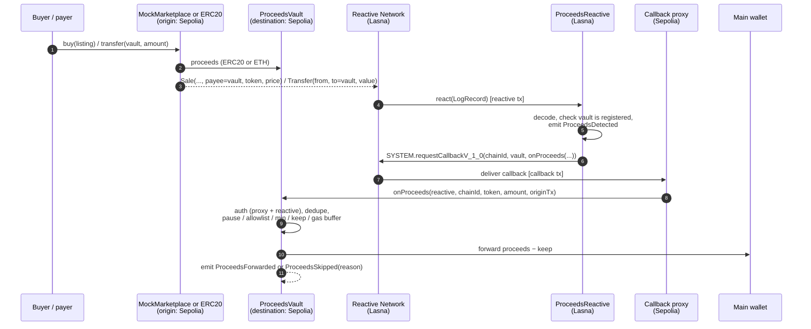
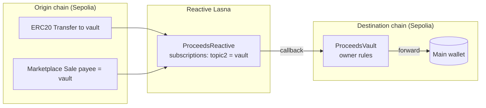

# Proceeds Auto-Forward

**Reactive Omni Buildathon · track: _Set It and Forget It_**

Sell something, get paid, and the money lands in your main wallet by itself. No bot, no keeper, no cron
job on a server you have to babysit.

Proceeds Auto-Forward pairs a small **vault** that collects payments and sale proceeds with a **reactive
contract** on Reactive Network. When money arrives at the vault (a direct ERC20 payment or a marketplace
sale paid in a token or in ETH), Reactive Network sees the event, runs the reactive contract, and sends a
callback that makes the vault forward the proceeds to the owner's main wallet, following rules the owner
set: which tokens, minimum amount, how much to keep back, and an ETH buffer that keeps paying for
callbacks.

Why it's useful: a hot "burner"/sales wallet should never sit on proceeds. Sellers, NFT creators, shops
taking stablecoin invoices and DAO treasuries can point their payout address at a vault and know funds
sweep to cold storage within seconds, under rules they control, with every step logged on-chain.

## Architecture





### Contracts

| Contract | Chain | Role |
| --- | --- | --- |
| `src/reactive/ProceedsReactive.sol` | Reactive Lasna | Owner registers routes. `watchToken(chainId, token, vault)` subscribes to `Transfer` with `topic2 = vault`; `watchMarketplace(chainId, market, vault)` subscribes to `Sale` with `topic2 = payee = vault`. `react()` decodes the log and requests a callback to the vault on the same chain. Ignores ERC721 transfers (`opCode` 4), zero amounts and unregistered vaults without reverting. |
| `src/destination/ProceedsVault.sol` | Sepolia (any supported chain) | `AbstractCallback`. `onProceeds` is guarded by `onlyServiceProvider` (callback proxy) **and** `onlyCallbackSender` (our reactive contract). Applies the owner's rules and never reverts on a business rule, so a rejected forward is a cheap `ProceedsSkipped` event instead of a billed `CallbackFailure`. |
| `src/mocks/MockMarketplace.sol` | Sepolia | Fixed-price marketplace with a payout address per listing; pays the payee in ERC20 or ETH and emits `Sale`. |
| `src/mocks/MockUSD.sol` | Sepolia | 6-decimal test stablecoin with an open `mint`. |

### Owner rules (vault)

| Rule | Setter | Effect |
| --- | --- | --- |
| Main wallet | `setMainWallet` | Where proceeds go. |
| Token allowlist + min + keep | `setTokenRule(token, allowed, minAmount, keep)` | Unlisted tokens stay in the vault; reported amounts below `minAmount` are skipped; `keep` is retained from each forward. `address(0)` = native ETH. |
| Native gas buffer | `setNativeGasBuffer` | ETH below this level is never forwarded, so the vault can keep paying callback fees. |
| Pause | `setPaused` | Proceeds accumulate; nothing is forwarded. |
| Escape hatch | `sweep(token, to, amount)` | Manual withdrawal of anything. |
| Revive | `coverDebt()` (public) | Settles callback-proxy debt from the vault balance. |

Safety details:
- **Dedupe**: one forward per `(originChainId, originTxHash, token)`. A marketplace sale in an ERC20 fires
  both the `Transfer` route and the `Sale` route; the second callback is skipped as `AlreadyProcessed`.
- **Never over-forwards**: the amount sent is `min(reported, spendable) − keep`, where native spendable
  excludes the gas buffer, so a bogus or inflated report can't move more than the vault actually holds.
- **Events for every step**: `ProceedsDetected` / `ForwardRequested` on Lasna; `CallbackReceived`,
  `ProceedsForwarded`, `ProceedsSkipped(reason)` on the vault; plus every config change.

Skip reasons: `0 Paused, 1 TokenNotAllowed, 2 BelowMinimum, 3 AlreadyProcessed, 4 NothingToForward,
5 TransferFailed`.

## Live deployment (testnet)

| | Address |
| --- | --- |
| ProceedsReactive (Lasna 5318007) | [`0x445C336410F0A49e45893e10c25E39B804F81BA8`](https://lasna.reactscan.net/address/0x445C336410F0A49e45893e10c25E39B804F81BA8) |
| ProceedsVault (Sepolia 11155111) | [`0xc1EEA4ddD643462402539726a99F1a7Ebd50dFE7`](https://sepolia.etherscan.io/address/0xc1EEA4ddD643462402539726a99F1a7Ebd50dFE7) |
| MockMarketplace (Sepolia) | [`0x406e7E7FA57f9534C9Ce350Afa4f23eF0F5faA6c`](https://sepolia.etherscan.io/address/0x406e7E7FA57f9534C9Ce350Afa4f23eF0F5faA6c) |
| MockUSD (Sepolia) | [`0xd16Be1D20f1FFee777F54BC2F65bD11A710E86c7`](https://sepolia.etherscan.io/address/0xd16Be1D20f1FFee777F54BC2F65bD11A710E86c7) |
| Sepolia callback proxy (Reactive) | `0xAa14d9Cd0f788Ca23d11805986C1d8bd035D23b4` |
| Deployer / owner / main wallet (demo) | `0xc1e54b2522627099ba45936CBa066e6adA928993` |

Vault rules in the demo: mUSD allowed, min 5 mUSD, keep 1 mUSD per forward; ETH allowed, min 0.00001 ETH.

### Full loops on-chain (event → reactive tx → callback)

| # | Scenario | Origin tx (Sepolia) | Reactive tx (Lasna) | Callback tx (Sepolia) | Result |
| --- | --- | --- | --- | --- | --- |
| 1 | Direct payment 25 mUSD, callback gas limit 500k | [0xe9aa95…b921](https://sepolia.etherscan.io/tx/0xe9aa95ef54686ff8c0be62243aad641f956295f9ea0b9adc086ae289cb0db921) | [0x2e2a60…2d3f](https://lasna.reactscan.net/tx/0x2e2a60a4ca94080c1dc2178f34ce42ac010e928c93aafdd7000730da2a852d3f) | [0x6917ef…afb8](https://sepolia.etherscan.io/tx/0x6917efaa098493ddba23295fb673af7e9a24f27d2a974d0b9c1a168bd736afb8) | `CallbackFailure`: out of gas (see note). Gas limit raised to 1M: [0x685788…a208](https://lasna.reactscan.net/tx/0x6857888679e223f6e68cfee9f2eabb299d4235bfb10a41c285a22514ba8ca208) |
| 2 | Direct payment 25 mUSD | [0xdc8a5b…a9e7](https://sepolia.etherscan.io/tx/0xdc8a5be179ad50bef4bd686599e9eb035cf44139cdd93b3a997bc2924c29a9e7) | [0x1482bb…6ea2](https://lasna.reactscan.net/tx/0x1482bb472585490347f3cbfe587a37c2c3164efb9695c15c89f66a7984196ea2) | [0xedb849…9705](https://sepolia.etherscan.io/tx/0xedb849ec2b8cb7ca9f23b67c2c6fba791432944a00587bc6e44aa603f1a79705) | **Forwarded 24 mUSD**, kept 1 |
| 3 | Marketplace sale 40 mUSD (fires Transfer **and** Sale routes) | [0x04d960…178f](https://sepolia.etherscan.io/tx/0x04d96024c32be76dcf0a8eb574bba84b0e1043cd8b357660db56aa9a4e52178f) | [0x17efa5…2b1b](https://lasna.reactscan.net/tx/0x17efa5d1113bfab7fcb266684b64a79593cc23da41374590223cf4ccf79f2b1b), [0x6ce056…c84c](https://lasna.reactscan.net/tx/0x6ce056117d98526afc3a188bc83ac6fa325670f575fceec6bb7ba308bc52c84c) | [0xd8f530…e775](https://sepolia.etherscan.io/tx/0xd8f5309d32eb35ed194e53733dc8f716eb7b1cc357c14bd45e4a17914afee775), [0x09fad7…3569](https://sepolia.etherscan.io/tx/0x09fad7a457754b6f86aadb3d07e7375d2f6a81f6c590960d3fd32c6fe7733569) | **Forwarded 39 mUSD** once; duplicate skipped (`AlreadyProcessed`) |
| 4 | Marketplace sale 0.0002 ETH | [0xe5c4c5…2d8e](https://sepolia.etherscan.io/tx/0xe5c4c5ffc4dd22a3af2b41092945311d5ebf8368c2a2fd1f86961bebf5c52d8e) | [0x44cc6b…2e35](https://lasna.reactscan.net/tx/0x44cc6bd43e057d7e7a103484e745817a4e73d832700ad52519e082d3f7132e35) | [0x1d29a5…6aff](https://sepolia.etherscan.io/tx/0x1d29a5a9d1a45f7179a88b0eb254ba4d83ba23ab911bdeb11c72e483b8916aff) | **Forwarded 0.0002 ETH**, gas buffer untouched |
| 5 | Dust payment 2 mUSD (< 5 min) | [0x48d3a5…6261](https://sepolia.etherscan.io/tx/0x48d3a5df11cab7dff80eda3a6aced7e5cdd6b446267c5def77c4f2d9a5b06261) | [0x6a5779…3776](https://lasna.reactscan.net/tx/0x6a57797e55974b9704528adb1428e72c876e366c3398e4f84221bc56c0a13776) | [0x0529ad…c1f8](https://sepolia.etherscan.io/tx/0x0529adfa2c81ea93ae691ab87d27d304878b6f93336675f01770a63b0a33c1f8) | Skipped (`BelowMinimum`), funds stay in vault |

Each callback costs the vault about 3·10⁻¹¹ ETH at current Sepolia prices; the reactive side cost about
0.013 lREACT per reactive tx in these runs (0.2 → 0.12 lREACT over 6 reactive txs).

**Note on loop 1:** the first callback ran with a 500k gas limit. The proxy withholds its own accounting
gas, and on current Sepolia a cold ERC20 transfer plus the dedupe write cost more than local estimates,
so `onProceeds` ran out of gas after the token transfer and the whole call reverted (nothing moved,
proxy logged `CallbackFailure`). The fix was a one-line owner call on Lasna (`setCallbackGasLimit(1_000_000)`),
and the default in `script/Deploy.s.sol` is now 1M. The 25 mUSD from loop 1 is still in the vault and
can be pulled with `sweep`.

## Setup

Requirements: [Foundry](https://book.getfoundry.sh/getting-started/installation), `jq`, a funded testnet key.

```bash
git clone <this repo> && cd proceeds-auto-forward
git submodule update --init --recursive     # forge-std, reactive-lib-omni, openzeppelin
forge build
forge test -vv                              # 21 tests incl. a fuzz test, all offline
```

Create `.env` from `.env.example` and `source` it (or export the variables).

### 1. Get lREACT

Send Sepolia ETH to the Reactive faucet (1 ETH → 100 lREACT, max 5 ETH per tx):

```bash
cast send 0x9b9BB25f1A81078C544C829c5EB7822d747Cf434 "request(address)" $YOUR_ADDR \
  --value 0.006ether --rpc-url $SEPOLIA_RPC --private-key $PRIVATE_KEY
```

### 2. Deploy the reactive contract (Lasna)

```bash
REACTIVE_FUNDING=200000000000000000 \
forge script script/Deploy.s.sol:DeployReactive --rpc-url $LASNA_RPC --private-key $PRIVATE_KEY \
  --broadcast --legacy --with-gas-price 100gwei
```

### 3. Deploy the vault and demo contracts (Sepolia)

```bash
REACTIVE=<ProceedsReactive> MAIN_WALLET=<your cold wallet> \
forge script script/Deploy.s.sol:DeployDestination --rpc-url $SEPOLIA_RPC --private-key $PRIVATE_KEY \
  --broadcast --legacy --with-gas-price 2000
```

Tip: Sepolia's base fee is currently a few wei, so a gas price of a few thousand wei is plenty. Contract
creation is gas-heavy there (the vault deployment used ~7.8M gas).

### 4. Register routes (Lasna)

```bash
REACTIVE=<..> VAULT=<..> TOKEN=<MockUSD> MARKET=<MockMarketplace> ORIGIN_CHAIN_ID=11155111 \
forge script script/Deploy.s.sol:ConfigureRoutes --rpc-url $LASNA_RPC --private-key $PRIVATE_KEY \
  --broadcast --legacy --with-gas-price 100gwei
```

### 5. Run a loop and trace it

`script/loop.sh` performs one origin action and then follows it to the reactive tx on Lasna and the
callback tx on Sepolia, appending the three hashes to `runs/loops.tsv`.

```bash
export REACTIVE=.. VAULT=.. TOKEN=.. MARKET=..
ACTION=direct     script/loop.sh my-direct      # 25 mUSD straight into the vault
ACTION=tokenSale  script/loop.sh my-sale        # marketplace sale paid in mUSD
ACTION=nativeSale script/loop.sh my-eth-sale    # marketplace sale paid in ETH (PRICE=wei)
ACTION=dust       script/loop.sh my-dust        # 2 mUSD, below the minimum -> skipped
```

Useful reads:

```bash
cast call 0x8888888888888888888888888888888888888888 "debt(address)(uint256)" $REACTIVE --rpc-url $LASNA_RPC
cast call 0xAa14d9Cd0f788Ca23d11805986C1d8bd035D23b4 "debt(address)(uint256)" $VAULT --rpc-url $SEPOLIA_RPC
cast call $VAULT "quoteForward(address,uint256)(uint256,uint256)" $TOKEN 40000000 --rpc-url $SEPOLIA_RPC
```

## Using it for real

- Put the vault on the chain where the money arrives (Base Sepolia `0x476F44b1…5585` and Unichain Sepolia
  `0x775c9B99…66C1` are the other testnet callback proxies; one reactive contract can serve vaults on all
  of them).
- Point marketplace payout addresses / invoice addresses at the vault, `watchToken` each stablecoin you
  accept and `watchMarketplace` each marketplace whose `Sale` event uses this layout, then set rules.
- Keep a little native currency in the vault (the gas buffer) and some REACT in the reactive contract;
  both expose a public `coverDebt()` so anyone can revive a stalled side.

## Tests

`test/ProceedsAutoForward.t.sol` runs the real contracts against a mock system contract (etched at
`0x8888…8888`) and a mock callback proxy that rewrites the first payload argument exactly like the
network. The `_relay()` helper turns recorded EVM logs into `LogRecord`s, feeds the ones matching the
contract's own subscriptions into `react()`, and delivers every requested callback, so each test is a
full local loop. Covered: direct payment, marketplace token sale with dedupe, native sale and the gas
buffer, below-minimum, non-allowlisted token, pause, main-wallet change, unregistered vault, ERC721
filtering, auth on both sides, replayed callbacks, inflated reports, owner-only config, unwatch, and a
fuzz test that a forward never exceeds the reported amount or the balance.

## License

MIT
